# `stream` RX and TX signal path: antenna pin to/from host sample

RX (antenna in -> host sample) and TX (host sample -> antenna out) for `apps/stream`.

```mermaid
flowchart LR
    subgraph RX["RX: pin to host sample"]
        direction TB
        R1["`**Antenna pin**
RF in`"]
        R2["`**Analog front end**
LNA, mixer, LO, AGC, LPF`"]
        R3["`**ADC**
10-bit I/Q`"]
        R4["`**Capture engine**
HW fills a DRAM bank`"]
        R5["`**esp_sdr_rx**
raw / CIC decimate / fold`"]
        R6["`**iq_pack**
8/12/16-bit packing`"]
        R7["`**vrt_rx.c**
VITA 49.2 packet`"]
        R8["`**transport_udp.c**
UDP/IPv6 send`"]
        R9["`**USB CDC-NCM**
cdc_ncm_eth0 + UDC dwc2`"]
        R10["`**Host NIC**
esdr0`"]
        R11["`**esp_sdr_lab.py / vrt_rx.py**
decode to IQ samples`"]
        R1 --> R2 --> R3 --> R4 --> R5 --> R6 --> R7 --> R8 --> R9 --> R10 --> R11
    end

    subgraph TX["TX: host sample to pin"]
        direction TB
        T1["`**esp_sdr_lab.py txstream / vrt_tx.py**
encode VITA packets`"]
        T2["`**Host NIC**
esdr0`"]
        T3["`**USB CDC-NCM**
UDC dwc2 + cdc_ncm_eth0`"]
        T4["`**vrt_tx.c**
UDP recv, decode, timestamp`"]
        T5["`**PSRAM ring buffer**
sample queue`"]
        T6["`**Bank fill**
leader filler, PIE/C interp
into the idle bank`"]
        T7["`**2 DAC banks**
loop mode, bank flip`"]
        T8["`**TX gain / force-on**
analog output stage`"]
        T9["`**Antenna pin**
RF out`"]
        T1 --> T2 --> T3 --> T4 --> T5 --> T6 --> T7 --> T8 --> T9
    end
```

Mermaid source

## Notes
- RX and TX share one physical RF front end / antenna pin: `esp_sdr_lock` makes them mutually
  exclusive in time, with `esp_sdr_set_turnaround()` controlling the settle (and optional retune)
  delay when switching direction.
- RX: the capture engine writes raw I/Q words directly into the selected DRAM bank; the CPU does
  not touch samples until `esp_sdr_rx_capture_iq()` reads that bank after the burst completes,
  or `esp_sdr_rx_capture_decimated()` / `_folded()` (`CONFIG_ESP_SDR_RX_DECIM`), selected per burst
  by `rx_mode`.
- TX: the network thread writes samples into a PSRAM ring (`esp_sdr_tx_dac.c`). The leading
  filler stages each block's input in internal RAM, interpolates it (S3 vector unit, or the C
  fallback split across both cores) into the idle one of two 64 KiB dump banks, and flips the
  bank select at the block's sample time. The DAC loops over the selected bank (`DAC_TRIG` bit 19
  held; `LOOP_LEAD`/`LOOP_STEP`/`LOOP_TAIL`), so output is gapless; input that arrives late plays
  as zeros.
- USB transport is CDC-NCM (an Ethernet-like network device over USB): both the RX VITA stream
  and the TX VITA command/data channel ride over UDP/IPv6 inside that virtual link, on different
  UDP ports.
